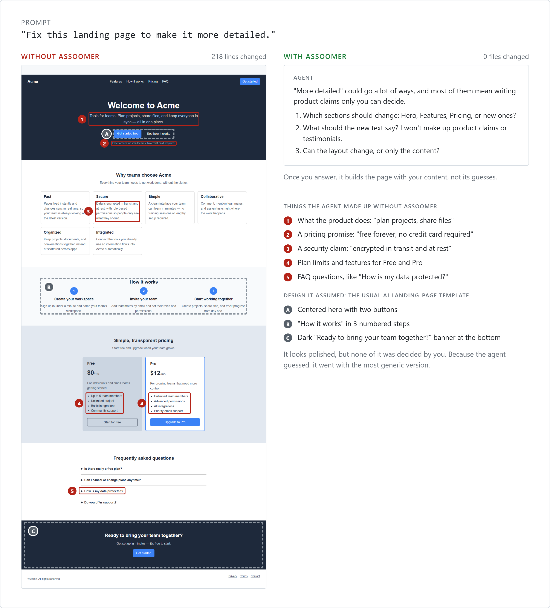
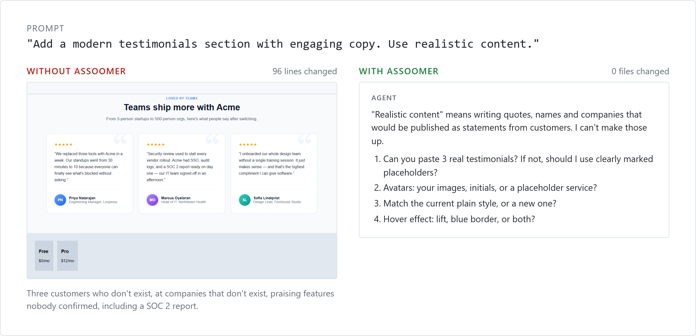
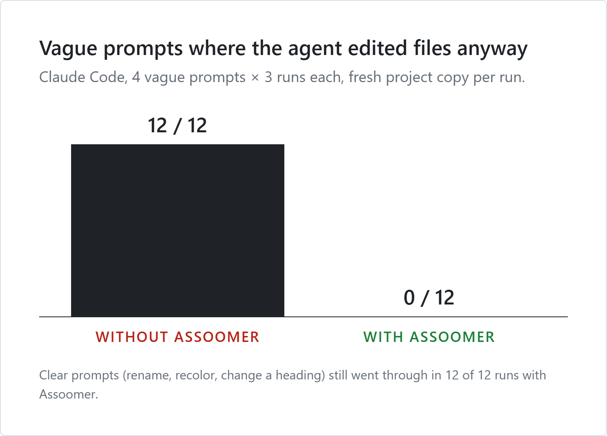

<p align="center">
  
</p>

<h1 align="center">Never letting your agent assooom</h1>

<p align="center"><b>Assoomer</b> is a skill for coding agents. It refuses vague requests instead of guessing what you meant.</p>

## With and without

These are real results from Claude Code in the same test project. The agent's replies are shortened.



When the agent has to guess, it guesses twice. It makes up the **content** (red): product claims, prices, and security promises. It also assumes the **design** (dashed): a centered hero with two buttons, "How it works" in three numbered steps, and a dark "Ready to…?" banner. That's the familiar vibe-coded look, and it comes from the same place as the made-up copy: the agent filled in decisions you never made with the most generic option.



Clear requests like "rename getUser to fetchUser" or "make the pricing background white" go straight through with no questions.

## It's for code too, not just design

Vague requests about code behave the same way. From the same test runs:

| Prompt | Without Assoomer | With Assoomer |
|---|---|---|
| "Clean up the code in this project." | Rewrote all 3 files, 70–100 lines each run | Asked how far to go: formatting only, modern syntax, or behavior changes? Should the `showUser(1)` call that runs on page load stay? |
| "Make it production-ready." | Rewrote all 3 files, 90–140 lines each run | Asked which parts count: HTML basics, accessibility, error handling, tooling, deployment? What check has to pass? |
| "Fix the bug in app.js." *(no bug described)* | *(not tested without Assoomer)* | Listed the 3 problems it found and asked which one you meant, and what users should see when it fails |

### You stay attached to your code

When the agent guesses, you end up with code you never decided on: error handling you didn't design, behavior you didn't ask for, refactors you didn't approve. It's in your codebase, but you don't really know it.

With Assoomer, **every decision in the code is one you made or explicitly handed over**, and the agent tells you what it chose for the small things. So you:

- **know what you approved.** Nothing was slipped in "while I was there".
- **can review faster.** The change matches what you asked for, so there are no surprises in the diff.
- **can explain and maintain it.** You made the calls, so you know why the code is the way it is.
- **can tell what's yours.** Anything the agent picked is listed in its reply, so you know exactly what to double-check.

## Choose how strict it is

`strict` asks about every detail. `balanced` (the default) makes small choices itself and tells you what it picked. `lenient` makes most "how" choices itself. No level lets it invent content or decide what gets built.

To change it, add one line to `CLAUDE.md` or `AGENTS.md`:

```
assoomer: lenient
```

Or set it for a single message:

```
assoomer: strict. Make the button bigger.
```

## Does it work?



This is a small test: one test website and 3 runs per prompt.

## Install

With [skills.sh](https://skills.sh), which works with Claude Code, Codex, Cursor, and other agents:

```bash
npx skills add b1tsoup/assoomer
```

To install it for all your projects instead of just the current one, add `-g`.

Or copy this folder into your agent's skills folder yourself:

| Agent | Put it here |
|---|---|
| Claude Code, all projects | `~/.claude/skills/assoomer/` |
| Claude Code, one project | `<your-project>/.claude/skills/assoomer/` |
| Other agents | Paste [`SKILL.md`](SKILL.md) into the agent's rules file (e.g. `AGENTS.md`, `.cursorrules`) |

That's it. It switches on by itself whenever you ask the agent to change something.

## FAQ

**Will it nag me about everything?**
No. Clear requests like "rename X to Y" or "make the background white" just get done.

**What if I don't care about a detail?**
Say so, for example *"style it however you like"*. The agent will pick something and tell you what it chose.

**Can I still ask for ideas?**
Yes. It will suggest options and wait for you to pick one.

## License

[MIT](LICENSE). You can use, change, and share Assoomer freely, including in commercial projects.

The avatar is the exception. It comes from the "Assoomer" meme, whose original creator is unknown, and isn't covered by the MIT license.
